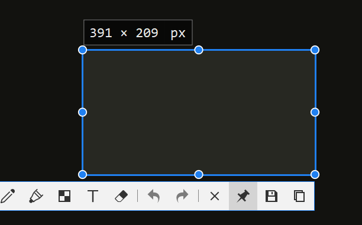
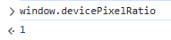
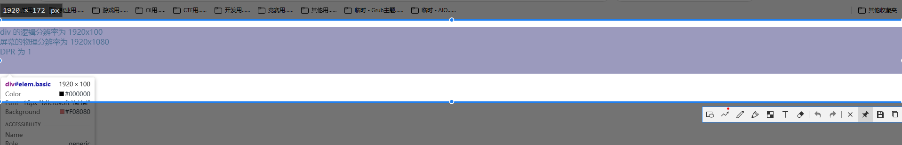
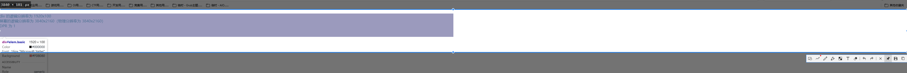
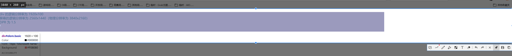
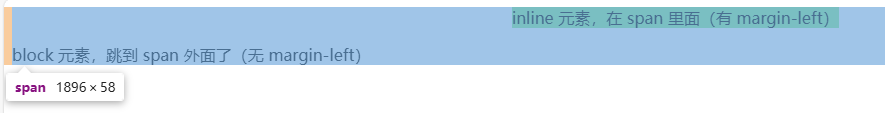
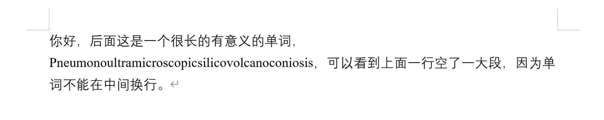
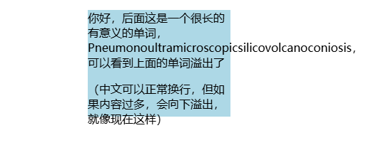
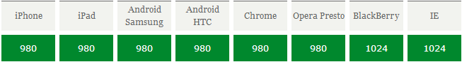

# CSS 相关

## 有关各种长度单位(px, em, ...)

网上说的各种概念，都写得十分难懂不直接，主要是没有与我们最直接接触的“**屏幕**”、及其“**显示器分辨率**”这些对应起来。  
也就是说了那么多，还是不知道 CSS 中`1px`对应我们显示器分辨率的多少像素。  
故这里：

1. 以“显示器分辨率”为出发点
2. 介绍 DPR：决定 CSS 中的`px`，与显示器分辨率中的`px`，两者的比例关系
3. 介绍 CSS 长度中的“国际单位”（绝对单位） - `px`
4. 介绍 CSS 长度中相对于字体`px`的单位 - `em`, `rem`
5. 介绍 CSS 长度中相对于窗口`px`的单位 - `vw`, `vh`, `vmin`, `vmax`
6. 介绍 CSS 长度中相对于父容器的单位 - `%`

### 有关物理屏幕

首先先介绍屏幕的一些重要概念：

* 尺寸：对应屏幕的**物理大小**，单位为"inch"(英寸)  
  如对于电脑屏幕常见的 15.6, 17.2 寸。  题:9），但总之这个指标是反应看在眼里/拿在手上的大小的。*
* **物理**分辨率：对应屏幕的**像素点个数**，**单位为"px"**  
  如常见的 1920x1080。  

  ⭐这个分辨率，就是我们日常接触到的、系统设置的分辨率。  
  在用各种截图软件时，会显示一个大小，**其就代表我们这个图片是“多少px * 多少px”的**。（如显示屏是 1920x1080，则截全屏就为 1920x1080）  
  

  *故这里自称为“物理分辨率”，为了**与后续 CSS 中“逻辑/虚拟分辨率”做区别**。*
* PPI(Pixels Per Inch)：每英寸的像素个数，单位为"px/inch"  
  这个指标才对应“**清晰程度/画质细腻程度**”这种**感觉**。  
  > 举例：
  >
  > 同样是 1080p，对于一个小屏幕 5.5 寸（PPI 约为 400 px/inch）和大屏幕 24 寸（PPI 约为 92 px/inch），明显大屏幕的会看着超糊（甚至可能直接看到每个方块像素点）  
  > *即如果追求显示清晰，则应该选高 PPI 的显示器（同尺寸下分辨率越高），而不仅是高分辨率的显示器。*

  PPI 的计算方式也自然就表示为“分辨率/尺寸”（准确来说是 斜对角线像素个数 / 尺寸）

### DPR(Device pixel ratio, 设备像素比)

然后引出 JS 中一个最重要的属性 - `window.devicePixelRatio`，  
其直接决定了：**CSS 当中`px`这个单位，对应屏幕分辨率多少`px`**。
*为了区分 CSS 和屏幕的`px`，后续将前者记为`px`/`px-css`、后者则特别记为`px-device`。*

这个属性的值，应该是 **JS 引擎内核**调用 OS 底层有关**屏幕显示信息**的 API **计算出来**的。
该属性值可以通过开发者工具的控制台直接查看，如下图。



⭐**计算方式**：

*其具体计算方式和原理暂时不清楚，但总之只与以下两个属性有关（个人测试如此，不一定完全正确）*。

1. **屏幕本身配置** $screen$  
   * 对于电脑屏幕：通常都是$1$（**无论分辨率、尺寸等是多少**）
   * 对于现代手机屏幕：通常都$\ge2$（如网上教程经常提到的“苹果 Retina 屏”则是$2$；我的一加 13 则是$4$）
2. **系统设置的缩放等级** $scale_{system}$  
   * Windows：在“设置 - 屏幕 - 缩放”里设置（100% 则是$1$；150% 则是$1.5$）
   * 安卓：通常在“显示大小”里设置（对于本人的手机，标准则是$1$；较小则是$0.875$）
3. 浏览器设置的缩放等级 $scale_{browser}$  
   需要注意：对于手机浏览器，缩放等级**不是双指放大缩小**，而是在设置里调整的（如 Chrome 的缩放；Edge 的字体大小）

最终的值则是：

$$
DPR = screen \times scale_{system} \times scale_{browser}
$$

*故对于电脑，DPR 就是：系统设置的缩放等级$\times$浏览器的缩放等级。*

---

以下介绍 CSS 的具体长度单位，**总共**有：

* 绝对单位：`px`, `pt`, `cm`
* 相对单位：`em`, `rem`, `vw`, `vh`, `vmin`, `vmax`, `%`

但常用的是`px`、`em/rem`、`vw/vh/vmin/vmax`、`%`，以下分别介绍。

### CSS 中长度的“国际单位”（绝对单位） - `px`

具有以下性质：

1. **`px`的“国际单位”性**

   对应于物理尺度中“国际单位”的概念，`px`可以看作 CSS 长度单位中的国际单位。  
   因为**相对单位（如`em`, `rem`）都是相对于`px`的**。

2. **`px`的相对性 - 如何对应到`px-device`**

   `px`是 CSS 中的一种**逻辑/虚拟单位**，**不直接对应**屏幕的`px-device`（即：设置`div`的`width: 500px`，用截图软件截图不一定是`500px-divice`）。
   那么`px`如何与设备屏幕的`px-device`对应上呢？  
   就是根据上面提到的`DPR`，公式如下：

   $$
   1\text{px} = DPR \times 1\text{px-device}
   $$

   > 实例 - 对于以下 HTML：
   >
   > ```html
   > <!DOCTYPE html>
   > <html lang="zh-CN">
   > 
   > <head>
   >     <meta charset="UTF-8">
   >     <title>px（逻辑分辨率）与 px-device（物理分辨率）的关系</title>
   > 
   >     <style>
   >         body {
   >             margin: 0;
   >         }
   > 
   >         .basic {
   >             background-color: lightcoral;
   >             height: 100px;
   >         }
   >     </style>
   > </head>
   > 
   > <body>
   >     <div id="elem" class="basic" style="width: 1920px;">
   >         <p id="DPR"></p>
   >     </div>
   > 
   >     <script>
   >         const elem = document.getElementById("elem")
   >         document.getElementById("DPR").innerHTML = `
   >             div 的逻辑分辨率为 ${elem.scrollWidth}x${elem.scrollHeight}<br \>
   >             屏幕的逻辑分辨率为 ${screen.width}x${screen.height}（物理分辨率为 ${screen.width * window.devicePixelRatio}x${screen.height * window.devicePixelRatio}）<br \>
   >             DPR 为 ${window.devicePixelRatio}
   >         `;
   >     </script>
   > </body>
   > 
   > </html>
   > ```
   >
   > 注：对于 Edge，其页面窗口横向会比浏览器窗口少一点（下图可以看到有个圆角）  
   >   
   > 故 1080p 无缩放最大化，对于上面的页面会稍微超一点、显示出横向滚动条。  
   > 可以在设置里将“试用 Microsoft Edge 的全新外观”全新外观关掉即可。
   >
   > 对于 PC，在浏览器无缩放的情况下：
   >
   > * 1080p 屏幕，`DPR=1`（系统缩放为 100%）：横向刚好占据整个屏幕  
   >   
   > * 4k 屏幕，`DPR=1`：横向只占据一半  
   >   
   > * 4k 屏幕，`DPR=1.5`（系统缩放为 150%）：横向占据 3/4  
   >   
   > 可以看到，如果使用`px`，**因为设备分辨率、缩放等级的不同，占据屏幕的比例也不同**。

3. **`px`的绝对性**

   说`px`是绝对单位，是因为“**CSS 的其他任何属性都无法影响他**”。  
   *区别于相对单位，`em`, `rem`是基于`font-size`这个属性的值而确定最终长度的，调整该属性值则能调整所有`em`, `rem`的最终长度（具体在下方讲解）*

   并且通过`DPR`运算后，最终会得到一个确定的`px-device`，也是绝对的值（假如`DPR=1`，设定`width=100px`，则截图这一部分横向分辨率就是`100`）。

   这一点，加上上面说的“因缩放等级不同导致占据屏幕比例不同”的原因，导致了`px`不适合应用于响应式布局。

### 相对于字体`px`的单位 - `em`, `rem`

> `em`名字的来源：
>
> `px`是 pixel 的简写，代表像素，因此顾名思义很容易知道其对应到像素，是绝对的。
>
> 而`em`，来源于印刷中“大写字母 M 的宽度”。  
> 这也是为什么`em`就是`font-size`的值的原因。  
> 因此如果改变字母的大小，则`em`这个单位代表的实际长度也会变化，是相对的。

如上面所说，`1em`为`font-size`设置的大小。  
而`em`, `rem`的区别如下：

* `em`：父容器的`font-size`  
  因此具有继承性，如：

  ```html
  <div style="font-size: 20px;">
      <div style="font-size: 2em;"> <!-- font-size 为 40px -->
          <div style="font-size: 2em;"> <!-- font-size 为 80px -->
              <div class="test" style="width: 2em;"></div> <!-- width 为 160px -->
          </div>
      </div>
  </div>
  ```

  上例如果将父容器（第三个`div`）改为`font-size: 20px`，则`width = 40px`。
* `rem`(root em)：根`<body>`容器的`font-size`  
  只与根`<body>`相关，故不具继承性。

### 相对于窗口`px`的单位 - `vw`, `vh`, `vmin`, `vmax`

>【TODO：已验证，错误！应该是`html.clientWidth/clientHeight`】
> 【与下面联合弄】
>
> 好像有点复杂：
>
> * PC 上：window.inner
> * 手机上：情况比较复杂，如果没有`<meta name="viewport" content="width=device-width, initial-scale=1">`，则可能为html.clientWidth（反正不是window.inner）；有的话就是了。


这里要引入`window`的另一个属性 - `window.innerWidth` / `window.innerHeight`，  
这两者就是**页面窗口（含占据空间的滚动条（如有））的宽度`px`和高度`px`**。

**注意**：不是`px_device`！  
也就是说，对于 1920x1080 屏幕，浏览器全屏，如果`DPR=2`，则`window.innerWidth = 960`。

可以在开发者工具里查看，找一个占满整个屏幕横向/纵向的元素，用选取工具查看其大小，其值则为`innerWidth`/`innerHeight`。
【TODO: 截图】

---

* `vw`：`window.innerWidth`的占比  
  如`50vw`，则是`50% * window.innerWidth`；`100vw`则是整个窗口的宽度。
* `vh`：`window.innerHeight`的占比
  如`20vh`，则是`20% * window.innerHeight`；`100vh`则是整个窗口的高度。
* `vmin`：`min(window.innerWidth, window.innerHeight)`的占比  
  如果宽度更小（手机），则是窗口宽度的占比
* `vmax`：`max(window.innerWidth, window.innerHeight)`的占比  
  如果宽度更大（PC / 平台），则是窗口宽度的占比
  这两者的应用：
  1. 让`width, height`都为`vmin`，可保证一定在页面内；都为`vmax`，可保证一定覆盖整个页面。
  1. `font-size`用`vmin`，可以保证移动端横竖屏字体大小一致。（虽然一般都不这么用）

### 相对于父容器`px`的单位 - `%`

很简单，就是相对于父容器**在该属性上的值的百分比**。  

如：

```html
<body style="font-size: 16px;">
    <div style="font-size: 3rem;">
        <p style="font-size: 50%;">这里的 font size 为 1.5rem(24px)</p>
    </div>
</body>
```

### 相对于

## 选择器

## 盒子模型

## position 定位

## display 布局

### 1. 对外布局（流式布局）：block, inline, inline-block

应该尽量多用`block`，对文字进行特殊样式标注采用`inline`

#### `block` - 块级元素

* 可以指定`width`, `height`属性：
  * `width`默认为`100%`：即等于父元素`width`（独占一行）
  * `height`默认为`auto`：即内部元素占多少，则是多少。

#### `inline` - 行内元素

**特性**：

* 不能指定`width`, `height`属性：两者都默认为`auto`，**靠内容撑开长宽、用多少占多少**。
* **行内元素里只能有行内元素**  
    即`<span>`里放`<p>`/`<div>`/...，理应是错误的，**应尽量避免这种错误！**  
    > 但 HTML 会自动修正，将其放置到最近的 block 父元素中，如下：
    >
    > ```html
    > <span style="margin-left: 500px; background-color: lightgreen;">
    >     inline 元素，在 span 里面（有 margin-left）
    >     <p> block 元素，跳到 span 外面了（无 margin-left）</p>
    > </span>
    > ```
    >
    >   
    >
    > 但从图片可以看出，选择工具看到的会不正常，本来 margin（橙色）是`500px`到第一行的左侧，但却没有；或者说第二行应该不属于这个`<span>`，但选择工具看到的仍算进去了。  
    > 故要尽量避免这种错误，防止 CSS 混乱！

特殊的：对于 HTML 内容里直接写的字符串，如`<p>内容</p>`的`内容`，是作为最标准的“行内元素”(`#text`)。

> 类比 - Word：
> 
> 类似于在 Word 中直接输入内容（文字/图片/各种`<span>`）：  
> 这一页则是父`<div>`，当输入文字会按需往后输入，当一行输满后（达到父`<div>`的`width`）则会切换到下一行。
>
> 一样的，英文默认不能从单词中间换行。对于 Word 会出现如下情况，  
>   
> 但对于 Word，单词非常长的话，会强制在中间换行保证不超出页面；而对于网页，单词非常长的话，则会超出到父`<div>`外面，如下，  
>
> ```html
> <div style="width: 200px; height: 150px; background: lightblue; margin: auto;">
>     <p>
>         你好，后面这是一个很长的有意义的单词，Pneumonoultramicroscopicsilicovolcanoconiosis，可以看到上面的单词溢出了
>     </p>
>     <p>
>         （中文可以正常换行，但如果内容过多，会向下溢出，就像现在这样）
>     </p>
> </div>
> ```
>
> 

### 2. 对内布局

有三个。  
直接用这三个，对外布局均为`block`；如果加上前缀`inline-`，则对外布局为`inline`。

### 3. 显示效果

#### none

#### content（不建议）

#### flex

#### grid

#### table

#### list-item

对外布局是`block`。  
相比于`block`，就是

### NaN. 未知

#### flow-root

#### flow（不建议使用）

#### ruby（不建议使用）

## 响应式布局

### 大小

单位都是逻辑/CSS分辨率`px`，而不是物理分辨率`px_device`（当 DPR = 1 时，两者统一）

* `screen`：整个屏幕
  * [固定]`width`/`height`：即屏幕**逻辑**分辨率（是物理分辨率除以 DPR）
  * [固定]`availWidth`/`availHeight`：**最大化**下可用的逻辑分辨率  
    *对于任务栏在下方的 Windows，`availHeight`则是屏幕逻辑分辨率 减 任务栏逻辑分辨率*  
    *对于手机，这两者相同。*
* `window`
  * `outerWidth`/`outerHeight`
    * 对于PC：整个**浏览器窗口**的逻辑分辨率。  
      如果是最大化，则约等于`screen.avail...`的值；如果是窗口化，则约等于窗口的逻辑分辨率。  
      *对于 Edge，该值相比 Snipaste 确定的逻辑分辨率会稍大一点（不知道为什么）。*  
      *一般不会用这个属性。*
    * [固定]对于手机：手机屏幕的逻辑分辨率，与`screen.width`/`screen.height`相同。  
      *如果用电脑模拟，就是手机型号旁边那个分辨率*  
      **故对于手机**：`screen.width`, `screen.availWidt`, `window.outerWidth`三者统一（`height`也一样）。
  * `innerWidth`/`innerHeight`
    * 对于 PC ：整个**页面窗口大小**，**包含滚动条**。  
      如果 DPR = 1，则通过 Snipaste 截图，放到页面窗口上，可得到其值。  
      **此时`vw`/`vh`这个单位即基于该值。**
    * 对于手机：比较复杂，是根据 Viewport(`visualViewport`) 定的。  
      1. 首先根据是否设置`<meta name="viewport" content="width=device-width, initial-scale=1">`，决定宽的基础值`width_base`
         * 设置了：则基础值`width_base`为 device-width（即`window.outerWidth`，如`375px`）
         * 没设置：则大多数`width_base`为`980px`（少部分为`1080px`）  
           
      2. 根据`html.scrollWidth`与`width_base`的大小关系
         * 如果`html.scrollWidth <= width_base`，则`innerWidth = width_base`，`innerHeight`等比放大
         * 如果`width_base < html.scrollWidth <= 4 * screen.width`，则`innerWidth = html.scrollWidth`
         * 如果`html.scrollWidth > 4 * screen.width`，则等于`innerWidth = 4 * screen.width`
* `<html>`元素(`document.documentElement`)
  * `clientWidth`/`clientHeight`
    * 对于 PC：  
      即页面窗口不含滚动条（如有且占据空间，则为`innerWidth`/`innerHeight`减去其宽度/长度）
    * 对于手机：
  * `offsetWidth`/`offsetHeight`
  * `scrollWidth`/`scrollHeight`
* `<body>`元素(`document.body`)  
  以下三者数值相等，都等于`html.offset`。
  * `clientWidth`/`clientHeight`
  * `offsetWidth`/`offsetHeight`
  * `scrollWidth`/`scrollHeight`
* `visualViewport`
  * 对于 PC：`windows.innerWidth`/`window.innerHeight`减去滚动条（**如果存在且占据空间**）
  * 对于手机：
    1. 首先根据是否设置`<meta name="viewport" content="width=device-width, initial-scale=1">`，决定基础值
       * 设置了：则`visualViewport`的`width`/`height`分别为 device-width/device-height（即`window.outerWidth`/`window.outerHeight`）
       * 没设置：则`visualViewport`的`width`/`height`分别为`window.innerWidth`/`window.innerHeight`
    2. 还需要考虑`scale`（**双指缩放**，而不是浏览器设置的缩放，可通过`initial-scale`设置）：在基础值上乘`scale`。

---

对于普通元素`client`, `scroll`, `offset`的定义：

* `client`：border 内的空间  
  即`client = content(width) + padding`，蓝色 + 绿色部分
* `offset`：可视部分占据的空间，**开发者工具中，选择元素看到的区域就是该属性**  
  即`offset = content(width) + padding + border`，蓝色 + 绿色 + 浅黄色部分（注：border 的颜色很容易干扰浅黄色）  
  故没有 border，则`client`与`offset`等价（`offset >= client`）。
* `scroll`：实际占据的完整空间，  
  （计算：子容器中最大的scroll+左margin？）（~~可以理解为：父容器无限大，则其会占据的空间~~），包含因overflow溢出到外面而无法显示的

### Viewport

Viewport 是针对移动端浏览器才有的概念（即 PC 端不需要考虑 Viewport），  
就是代表其**页面大小**（`window.innerWidth`）。【TODO：应该是错的】

* Viewport 默认值通常为`980px`（少数为`1024px`）

## 一些效果实例

### 1. 分栏布局