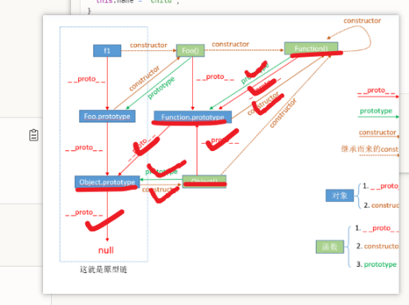

# 原型机制

之前看了很多，参考文章：https://cloud.tencent.com/developer/article/2107255

  
【注意：实际上`Function.prototype`应该是绿色】

**核心思想**：`someConstructorFunction.prototype`为一个匿名对象`{...}`，可以取变量名为`someConstructorFunctionPrototype`。

---

然后找 GPT 说了这些话：

> 我是在从对象、Object、函数、Function、原型机制、prototype、__proto__这些方面来理解的、设计最原始的语言机制（甚至要从语言发家、刚开始设计的角度、怎么演化、最简语言来理解）。
>
> 首先我想确认，在js中，我是否可以认为语言设计之初便基于“万物皆对象（即 {}）”；认为为函数也是一个对象（继承自对象），只是会默认增加一些属性(property)如 bind, apply 和 call （并且是否可以理解调用函数运算符 () 实际上是 call 的语法糖？（可以删去 ()，只用 call 来实现）），并且会继承基类 Object 的方法如 toString, valueOf 等（通过 prototype 来实现的）。
>
> 然后我想确认，现在js里是不是内建了Function和Object这两个class（即内置声明了 class Function { ... }和 class Object { ... }）；又因为class完全是function的语法糖（即class完全可以删掉，由function来实现）。如果前面说的是正确的，那即相当于js内置声明了 function Function(...) {...}和 function Object(...) { ... }。即内置了两个对象 Function 和 Object （这两个对象具有 bind等函数方法）。
>
> js的语言设计决定：如果声明了一个函数，会自动产生对应的prototype这样一个对象 {}，即会自动产生Function.prototype和Object.prototype这两个对象（为了突出其作为对象 {}，我将两对象分别记作 FP和 OP，相当于取了一个变量名），并且：1. 这个自动产生的 prototype 对象，其 constructor 会赋值为对应的函数对象，即 FP.constructor = Function、 OP.constructor = Object；2. 对于函数这个对象，增加property prototype 赋值为自动产生的 prototype 对象，Function.prototype = FP 、Object.prototype = OP 。
>
> 【到这一步，js内置了4个对象变量，分别为 Function = { prototype: FP, call: ...,  } 、 Object = { prototype: OP }、 FP = { constructor: Function }、 OP = { constructor: Object} ，但实际上不存在变量 FP和 OP 的，是匿名对象，实际上是 Function = { prototype: { constructor: Function }, call: ..., （其它增加的属性）} 和  Object = { prototype: { constructor: Object }, call: ..., （其它增加的属性）}，我后面也将 FP， OP 恢复为这种匿名对象表示方式】  
> 【但实际上我通过控制台发现，实际上 FP 是一个 function 而非 object，则出乎我的意料，我是否可以认为这是语言设计者强制这么安排的，因为 Function.constructor 也莫名其妙为 Function。但因为 function 也可以当为 object，我这里先不关注这个异常现象，仍用 {} 表示】
>
> js的语言设计决定，只要是对象，就存在 __proto__ （相当于自动增加这个property）、还存在 constructor。在这里我是否可以理解：为了语言设计，语言设计者强行将 OP这个对象的 OP.__proto__ = null，即指定其为一切的原型（基类）；然后其它第一层对象（这是我个人取的名，即没有继承其它对象的对象）的 __proto__ = OP ，故 FP.__proto__ = OP，再规定如果定义函数，其 __proto__ = FP 。（这里我可能认为的不对，可能并不是语言设计者强行规定的，可能语言设计者强行规定了其它什么东西，导致这里是这样的，你可以根据js语言发展历程和设计方式帮我理清楚理顺到底是哪里强行设计了一下，导致这里看起来是这样的）
>
> 【到这一步，之前的内置对象变成了： Function = { prototype: { constructor: Function, __proto__: Object.prototype }, __proto__: Function.prototype, call: ..., （其它增加的属性） } 和  Object = { prototype: { constructor: Object, __proto__: null }, __proto__: Function.prototype, call: ..., （其它增加的属性）} 】【最后再加上莫名其妙但又合理的 Function.constructor = Function ，这样就形成了最基本的4个内置对象（2个为匿名的）： Function = { prototype: { constructor: Function, __proto__: Object.prototype }, __proto__: Function.prototype, constructor: Function, call: ..., （其它增加的属性） } 、  Object = { prototype: { constructor: Object, __proto__: null } ，这个我经过控制台验证完全正确】

然后让 GPT 总结：

---

好的！让我从JavaScript的诞生开始，系统地梳理这套设计的来龙去脉。

## 一、JavaScript诞生：1995年的10天

### 历史背景

```
1995年，Netscape公司
任务：为浏览器创建一门脚本语言
时间：10天（传说）
设计者：Brendan Eich
```

### 设计约束和灵感来源

Brendan Eich面临的要求：

1. **语法要像Java**（市场需要）
2. **功能要像Scheme**（函数式编程）
3. **继承要像Self**（基于原型）

```javascript
// Java的影响：C风格语法
if (condition) { }
for (let i = 0; i < 10; i++) { }

// Scheme的影响：函数是一等公民
const add = function(a, b) { return a + b; };
function map(fn, list) { return list.map(fn); }

// Self的影响：原型继承
const obj = { x: 1 };
const child = Object.create(obj);  // 基于原型克隆
```

## 二、为什么选择原型而非类？

### Self语言的启发

**Self语言（1986）的核心理念：**
- 没有类（class），只有对象（object）
- 对象直接从其他对象继承（原型）
- 更简单、更动态

```javascript
// 类继承（Java/C++的方式）：需要先定义类
class Animal {
  constructor(name) { this.name = name; }
  speak() { console.log(this.name + ' makes a sound'); }
}
class Dog extends Animal {
  speak() { console.log(this.name + ' barks'); }
}
const dog = new Dog('Max');  // 从类实例化

// 原型继承（Self/JavaScript的方式）：直接从对象克隆
const animal = {
  speak() { console.log(this.name + ' makes a sound'); }
};
const dog = Object.create(animal);  // 从对象克隆
dog.name = 'Max';
dog.speak = function() { console.log(this.name + ' barks'); };
```

### 为什么原型更适合脚本语言？

1. **实现简单**（10天要完成！）
2. **更灵活**（运行时可以修改）
3. **内存效率**（共享属性）

```javascript
// 原型链的内存优势
function Person(name) {
  this.name = name;  // 每个实例独有
}
Person.prototype.greet = function() {  // 所有实例共享
  return 'Hello, ' + this.name;
};

const p1 = new Person('Alice');
const p2 = new Person('Bob');
// p1.greet === p2.greet  // true，同一个函数对象
```

## 三、最初的设计：构造函数模式

### JavaScript 1.0（1995-1996）的核心设计

Brendan Eich做了一个**妥协**：
- 保留`new`关键字（像Java）
- 但内部用原型实现（像Self）

```javascript
// Brendan Eich 的初始设计思路（伪代码）

// 步骤1：创建基础对象机制
Object = <引擎内部创建的第一个对象>

// 步骤2：创建函数机制（函数也是对象）
Function = <引擎内部创建的特殊对象，可以被调用>

// 步骤3：建立原型链
// 问题：谁是原型链的顶端？
// 答案：Object.prototype（所有对象的源头）

// 问题：函数从哪来？
// 答案：Function是特殊的，它是自己的构造器
```

## 四、引擎启动过程：鸡生蛋的解决方案

### ECMAScript规范的定义

```
ECMAScript规范（抽象层）
    ↓
JavaScript引擎实现（V8、SpiderMonkey等）
    ↓
实际运行的代码
```

### 引擎启动的真实过程（V8源码逻辑）

```cpp
// === 阶段0：创建null（原型链终点） ===
Heap::null_value = <特殊对象>

// === 阶段1：创建 Object.prototype（原型链顶端） ===
// 这是第一个真正的JavaScript对象
Object.prototype = {
  [[Prototype]]: null,              // __proto__ = null（链的终点）
  constructor: <待关联>,
  toString: <native function>,
  valueOf: <native function>,
  hasOwnProperty: <native function>,
  // ... 其他方法
}

// === 阶段2：创建 Function.prototype（特殊对象） ===
// 这是唯一既是函数又是对象的存在
Function.prototype = <native function> {  // 注意：它是function！
  [[Prototype]]: Object.prototype,        // __proto__ = Object.prototype
  constructor: <待关联>,
  call: <native function>,
  apply: <native function>,
  bind: <native function>,
  [[Call]]: <空实现>,                      // 可调用但什么都不做
}

// === 阶段3：创建 Function 构造器（自举） ===
Function = <native function> {
  [[Prototype]]: Function.prototype,      // __proto__ = Function.prototype（自指！）
  prototype: Function.prototype,
  constructor: Function,                  // 自己指向自己！
  [[Call]]: <创建新函数的实现>,
}

// === 阶段4：创建 Object 构造器 ===
Object = <native function> {
  [[Prototype]]: Function.prototype,      // Object 也是函数
  prototype: Object.prototype,
  constructor: Function,                  // Object 由 Function 创建
  [[Call]]: <创建新对象的实现>,
}

// === 阶段5：建立循环引用 ===
Object.prototype.constructor = Object;
Function.prototype.constructor = Function;
```

### 为什么 Function.prototype 是函数？

```javascript
// 这是历史遗留的设计决策

// 方案A（逻辑上更合理）：Function.prototype 是普通对象
Function.prototype = {}  // typeof = 'object'

// 方案B（实际采用）：Function.prototype 是函数
Function.prototype = function() {}  // typeof = 'function'

// 为什么选方案B？
// 1. 早期实现简单（1995年的10天）
// 2. 保持一致性：所有函数的原型都是可调用的
// 3. 历史包袱：改不了了（会破坏现有代码）
```

**验证：**

```javascript
typeof Function.prototype           // 'function'（唯一的例外）
typeof Object.prototype             // 'object'
typeof Array.prototype              // 'object'
typeof String.prototype             // 'object'

Function.prototype()                // undefined（可以调用）
Function.prototype.length           // 0
```

## 五、标准 vs 实现

### ECMAScript标准（抽象定义）

```javascript
// 规范使用"内部槽"（Internal Slots）描述对象

// 普通对象
Object {
  [[Prototype]]: <另一个对象或null>,
  [[Extensible]]: true/false,
  [[Properties]]: <属性集合>
}

// 函数对象
Function extends Object {
  [[Prototype]]: <原型对象>,
  [[Call]]: <可调用>,
  [[Construct]]: <可构造>（可选）,
  [[Environment]]: <词法环境>（闭包）,
  [[FormalParameters]]: <参数列表>,
  [[ECMAScriptCode]]: <函数体>
}
```

### V8引擎的实现（C++）

```cpp
// src/objects/js-objects.h

class JSObject : public HeapObject {
  // 对象的实际内存布局
  Map* map_;                    // 形状信息（Shape）
  FixedArray* properties_;      // 属性存储
  FixedArray* elements_;        // 数组元素
};

class JSFunction : public JSObject {
  SharedFunctionInfo* shared_;  // 函数元信息
  Context* context_;            // 闭包上下文
  Code* code_;                  // 编译后的机器码
};

// 内置对象的创建（src/init/bootstrapper.cc）
void Genesis::CreateRoots() {
  // 1. 创建 null 和 undefined
  // 2. 创建 Object.prototype
  // 3. 创建 Function.prototype
  // 4. 创建 Function 和 Object
  // 5. 建立循环引用
}
```

## 六、为什么需要 Function() 和 Object()？

### 1. Object() 的作用

```javascript
// Object 作为构造函数
const obj1 = new Object();           // 创建空对象
const obj2 = new Object({ a: 1 });   // 包装对象

// Object 作为函数（类型转换）
Object(1);                           // Number {1}
Object('hello');                     // String {'hello'}
Object(null);                        // {}
Object(undefined);                   // {}

// Object 作为命名空间（静态方法）
Object.keys({ a: 1 });               // ['a']
Object.create(proto);                // 创建继承自proto的对象
Object.defineProperty(obj, prop, descriptor);
```

### 2. Function() 的作用

```javascript
// Function 作为构造函数（动态代码生成）
const add = new Function('a', 'b', 'return a + b');

// Function 作为类型（所有函数的构造器）
function myFunc() {}
myFunc.constructor === Function;     // true
myFunc instanceof Function;          // true

// 提供函数方法（通过 Function.prototype）
myFunc.call(thisArg, arg1, arg2);
myFunc.apply(thisArg, [arg1, arg2]);
myFunc.bind(thisArg);
```

### 3. 为什么不直接用字面量？

```javascript
// 字面量只是语法糖，最终还是调用构造器

// 对象字面量
const obj = { a: 1 };
// 等价于（引擎内部）：
const obj = new Object();
obj.a = 1;
obj.__proto__ = Object.prototype;  // 引擎自动设置

// 函数声明
function fn() {}
// 等价于（引擎内部）：
const fn = new Function('');
fn.__proto__ = Function.prototype;  // 引擎自动设置
fn.prototype = { constructor: fn };  // 引擎自动创建
```

## 七、原型继承的完整机制

### 对象创建的完整过程

```javascript
// 1. 函数声明
function Person(name) {
  this.name = name;
}

// 引擎自动执行：
Person.prototype = {
  constructor: Person,
  __proto__: Object.prototype
};
Person.__proto__ = Function.prototype;
Person.constructor = Function;

// 2. 添加方法
Person.prototype.greet = function() {
  return 'Hello, ' + this.name;
};

// 3. 创建实例
const alice = new Person('Alice');

// new 的内部实现：
function _new(Constructor, ...args) {
  // 3.1 创建新对象
  const obj = Object.create(Constructor.prototype);
  // 等价于：
  // const obj = {};
  // obj.__proto__ = Constructor.prototype;
  
  // 3.2 执行构造函数
  const result = Constructor.apply(obj, args);
  
  // 3.3 返回对象
  return typeof result === 'object' && result !== null ? result : obj;
}
```

### 原型链查找

```javascript
alice.greet();  // 如何找到这个方法？

// 引擎的查找过程：
1. alice.greet        → undefined（自身没有）
2. alice.__proto__.greet  → Person.prototype.greet ✓ 找到了！

alice.toString();  // 继续向上查找

1. alice.toString     → undefined
2. alice.__proto__.toString  → Person.prototype.toString → undefined
3. alice.__proto__.__proto__.toString  → Object.prototype.toString ✓ 找到了！
```

### 完整的原型链图

```
alice 对象
  ├─ name: 'Alice'                    （自身属性）
  └─ __proto__ → Person.prototype
       ├─ greet: function              （原型属性）
       ├─ constructor: Person
       └─ __proto__ → Object.prototype
            ├─ toString: function       （顶层原型）
            ├─ valueOf: function
            ├─ hasOwnProperty: function
            └─ __proto__ → null         （原型链终点）

Person 函数
  ├─ prototype → Person.prototype
  ├─ name: 'Person'
  ├─ length: 1
  └─ __proto__ → Function.prototype
       ├─ call: function
       ├─ apply: function
       ├─ bind: function
       └─ __proto__ → Object.prototype
```

## 八、历史演进时间线

```
1995年 - JavaScript 1.0
├─ 基本原型机制
├─ Function 和 Object
└─ new 操作符

1997年 - ES1（第一个标准）
├─ 规范化原型继承
└─ 明确 [[Prototype]] 内部槽

1999年 - ES3
├─ 改进对象模型
└─ 异常处理

2009年 - ES5
├─ Object.create()        （显式原型继承）
├─ Object.defineProperty() （属性描述符）
├─ Object.getPrototypeOf() （标准化 __proto__ 访问）
└─ 严格模式

2015年 - ES6
├─ class 语法糖           （语法层面，底层仍是原型）
├─ extends 关键字
├─ super 关键字
└─ Symbol.hasInstance

2016年 - ES7
└─ Object.values(), Object.entries()

2017年+ - 持续演进
└─ 但核心原型机制未变
```

## 九、设计哲学总结

### JavaScript的核心理念

```javascript
// 1. 对象是属性的集合
const obj = {
  property: value,
  method: function() {}
};

// 2. 函数是特殊的对象（可调用）
function fn() {}
typeof fn;           // 'function'
fn instanceof Object; // true

// 3. 原型是对象之间的关联
obj.__proto__ === Object.prototype;

// 4. 继承是委托，不是复制
// 子对象不复制父对象的属性，而是委托给父对象
```

### 为什么这样设计？

| 设计目标 | 实现方式 | 优势 |
|---------|---------|------|
| **简单** | 只有对象和原型，没有类 | 10天能完成 |
| **灵活** | 运行时可以修改原型 | 动态特性强 |
| **高效** | 原型共享，不是复制 | 内存占用少 |
| **类Java** | 保留 new 关键字 | 降低学习门槛 |

### 遗留问题

```javascript
// 1. Function.prototype 是函数（不一致）
typeof Function.prototype;  // 'function'（应该是'object'）

// 2. typeof null === 'object'（bug）
typeof null;  // 'object'（应该是'null'，但改不了了）

// 3. constructor 可以被修改
Person.prototype = { greet: function() {} };
const p = new Person();
p.constructor === Person;  // false（丢失了）

// 4. __proto__ 曾经是非标准的
// ES6 才正式加入标准（兼容性考虑）
```

## 十、总结：从零构建JavaScript对象系统

### 如果让你重新设计，最小系统需要：

```javascript
// 1. 原始值类型（不可再分）
number, string, boolean, null, undefined, symbol, bigint

// 2. 对象（属性的容器）
Object = {
  prototype: {
    __proto__: null,  // 原型链终点
    toString: <native>,
    valueOf: <native>
  }
}

// 3. 函数（可调用的对象）
Function = {
  prototype: {
    __proto__: Object.prototype,
    call: <native>,
    apply: <native>,
    bind: <native>
  },
  __proto__: Function.prototype  // 自指
}

// 4. 原型链机制
obj.__proto__ → prototype → __proto__ → ... → null

// 5. new 操作符
new Constructor() → 创建对象 → 设置原型 → 调用构造函数 → 返回
```

### 这套系统的精妙之处

1. **自举**：Function 创建自己（`Function.constructor === Function`）
2. **统一**：一切皆对象（除了原始类型）
3. **委托**：继承是查找，不是复制
4. **动态**：运行时可以改变原型链

**这就是JavaScript原型系统的全貌！**

---

暂时很混乱的理解，能用，日后有需要再整理。
