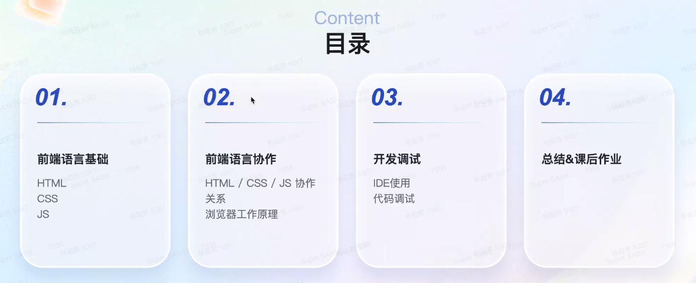
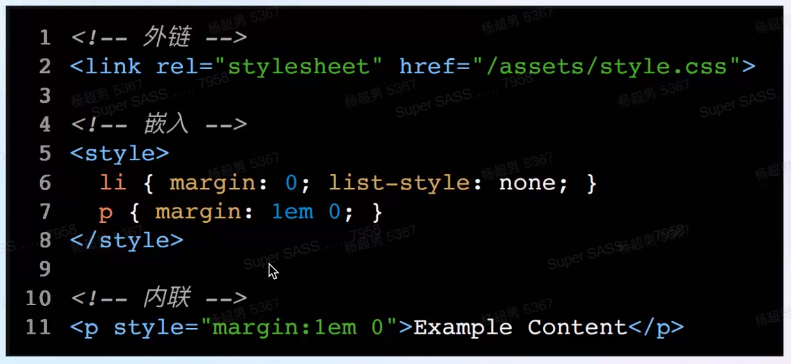
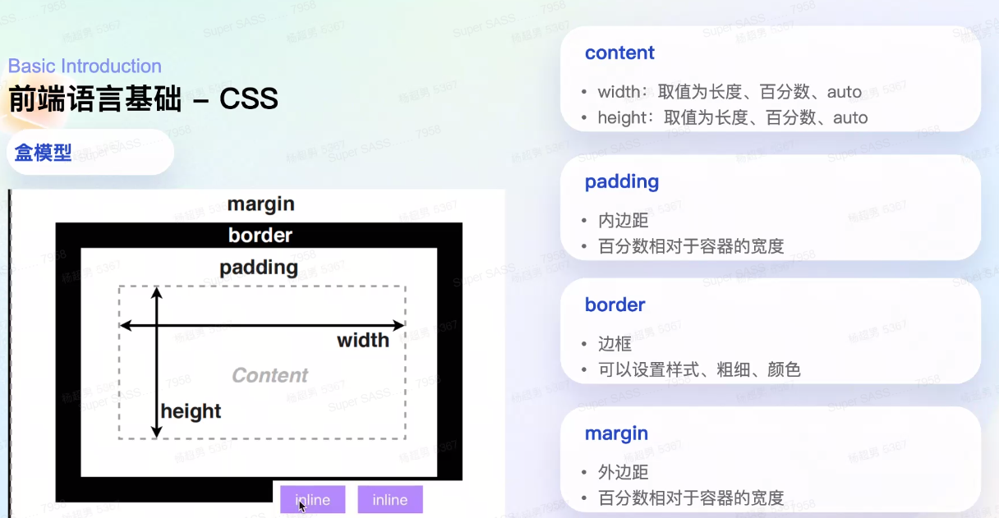
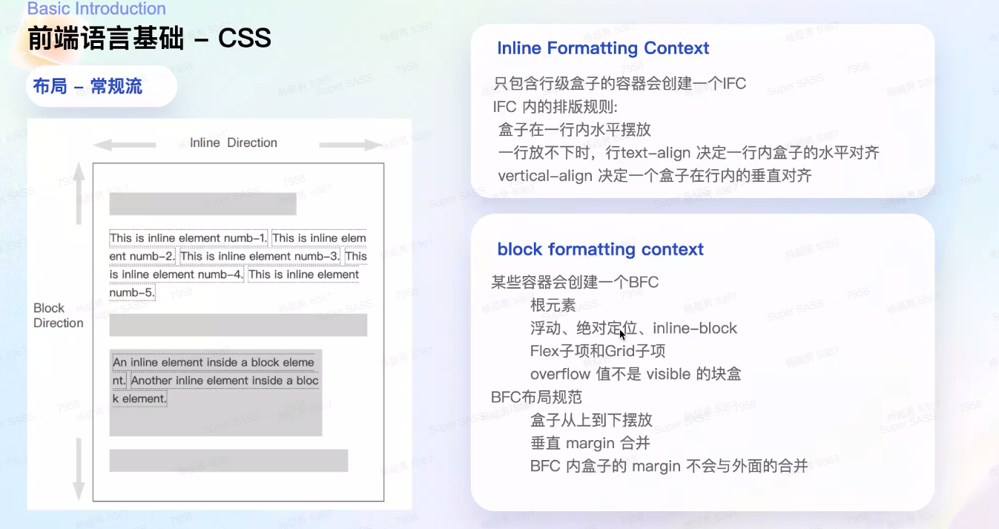
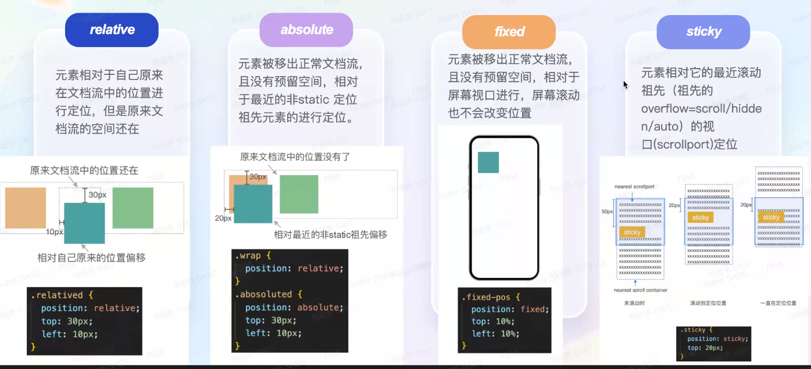
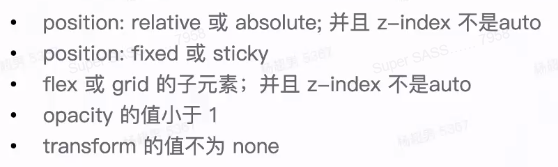
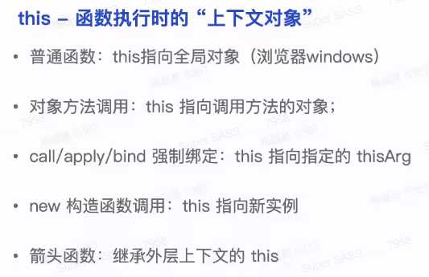
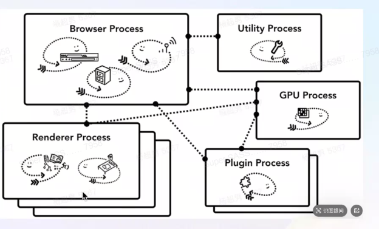
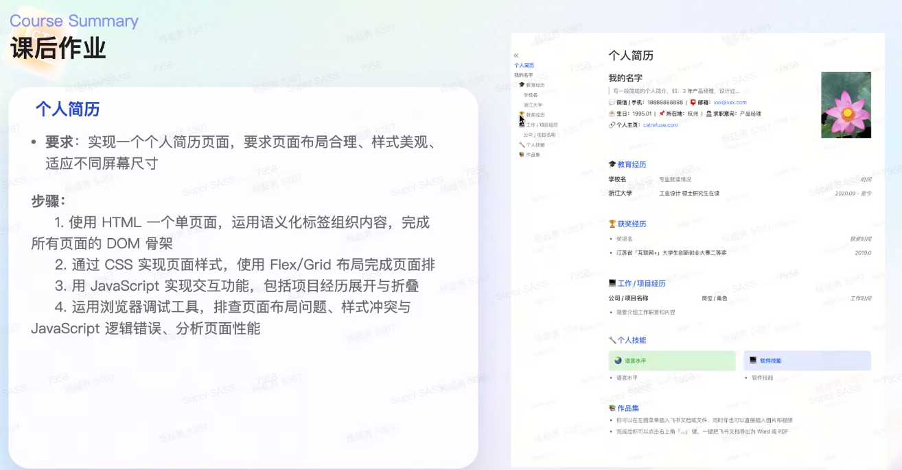

# 第一课 - Web 基础和开发调试

## 一、前端语言基础 - 三剑客

* HTML - 骨骼
* CSS - 皮肤
* JS - 肌肉（赋予功能）

### 1. HTML

* 超文本：比普通文本更丰富、可表示单个网站内或多个网站间的网页链接
* 标记语言：只做文本的结构、格式、数据，没有执行逻辑

**特点**：

* 有结构：`<> </>`、`</>`、属性
* 可嵌套
* 大小写不敏感（习惯小写）

**基本结构**：

* `<!DOCTYPE html>`：声明是 HTML5 标准
* `<html>`
  * `<head>`：不展示给用户，承载给浏览器/其它服务商等功能
    * `<meta>`：元数据，浏览器理解解析
    * `<link>`：外部链接，如标签页logo、第三方资源  
      其中`rel=dns-prefetch`用于性能优化，提前进行 dns 解析，以便获取资源省略这步
    * `<script>`：嵌套 JS 代码
    * `<title>`：标签页标题
  * `<body>`

#### body 详解

**元素类别**：

* 内联元素
  * 只能嵌套文本或其它 inline 元素
  * 如`<a>`, ` `, `<code>`
* 块级元素
  * 占据整行，并从新行开始
  * 能嵌套 block/inline
  * 如`div`, `
`
* 行内块级元素`inline-block`  
  * 能控制尺寸的内联元素
  * 如``, `<input>`

#### HTML 5

**特点**：

1. 语义化：`
` -> `<header>`
2. 表单增强：数据校验、输入提示等
3. 多媒体：`<audio>`
4. 绘图：绘图的 API，用于做游戏/数据可视化
5. 存储：`localStorage`, `sessionStorage`
6. 异步线程：Web Workers
7. 不中断通讯方式：WebSocket

### 2. CSS

* 层叠：样式可以层层堆叠/覆盖，有冲突，需要解决冲突
* 样式表：规则声明的集合

**技术**：

* 选择器
* 优先级和继承
* 盒模型
* 布局和定位

**如何引入**：

#### (1) 选择器

**基础**：

* 通配选择器 `*`
* 元素选择器 `div`
* ID 选择器 `#`
* 类选择器 `.`
* 属性选择器 `[]`
* 伪类选择器 `:`：如`:after`
* 位元素选择器 `::`：如`::first-line`（第一行）

**组合**：

* 后代选择器 ` `
* 子元素选择器 `>`
* 相邻兄弟选择器 `+`
* 通用兄弟组合器 `~`

#### (2) 优先级

**按从高到低**。

1. 样式表来源
   1. 用户代理样式表`!important`
   2. 作者样式表`!important`
   3. 作者样式表
   4. 用户代理样式表
2. 选择器：越精确越高
   1. 内联
   2. id
   3. 类、属性、伪类
   4. 伪元素、元素
3. 源码顺序：越后越高  
   有不可控因素

#### (3) 继承

某些属性会自动继承父元素的值，通常与文本属性有关。

#### (4) 盒模型

* 类型`display`：inline/block
* 计算方式`box-sizing`：设置尺寸时包不包含边界

存在现象“边距折叠”，即`margin`重合在一起。

#### (5) 布局

**默认布局**：

* 内联格式化上下文(IFC)：在一个行内水平一个个排放。
  * `text-align`、`vertical-align`：水平垂直对齐
* 块级格式化上下文(BFC)
  * 盒子单独占一行、从上到下摆放
  * 垂直`margin`合并，即边距折叠现象。

**定位**：

* `relative`：**相对自己原来**的位置移动，不脱离文档流（原来位置还会占用）
* `absolute`
* `fixed`：固定在页面
* `sticky`：滚动吸顶/吸底

**层叠上下文**：

`z-index`

* 只在同一级内比较
* 子元素无法超越父元素（如父元素4，子元素6，则无法超过4）

有生效条件：

#### (6) flex 自适应布局

* 父容器 - flex container  
  属性跟布局相关，  
  其中定义内部的布局（横向纵向）、对齐方式、子元素间隔`gap`、
* 子元素 - flex item  
  属性跟缩放相关，  
  默认大小、增长比例、缩小比例

#### (7) grid 网格布局

> 与 flex 区别：
>
> * `flex`：逐行来看，是一维的布局方式
> * `grid`：需要先创建整体，是二维的布局方式

#### (8) 动画、响应式

* 动画
  * `transform`
  * `transition`
* 响应式：
  * 媒体查询
  * 相对长度`em`

### 3. JS

**特点**：

* 单线程
* 动态弱类型（不检查数据类型、可被重新赋值不同类型）
* 面向对象、面向函数
* 解释性语言

#### (1) 数据类型

* `String`
* `Number`
* `Boolean`
* `Null`
* `Undefined`
* `Symbol`
* `Object`
  * `Array`
  * `Function`
* `BigInt`

#### (2) 作用域

* 全局作用域
  * 全局可访问
  * 容易造成全局污染
  * 脚本销毁释放
  * 存在var变量提升（后声明的可以先访问）
* 函数作用域
  * 函数内部可访问
  * 函数结束释放
  * 存在var变量提升
* 会级作用域
  * 块内部可访问
  * 快执行结束释放

#### (3) 执行方式

* 有关上下文，以栈的形式
* 首先创建全局执行上下文，然后在遇到函数时创建函数执行上下文
* 包括
  * Scope：变量
  * Outer：上下文链（因此内部的可以访问到外部的变量）
  * `this`：函数执行时的“上下文对象”

#### (4) this

#### (5) 闭包

* 表现：函数执行完毕，其关联的词法环境未被垃圾回收，仍能被外部引用访问
* 特点：变量私有化、持久化
* 权限：内存泄露

#### (6) 事件

JS 是单线程的，对于每一行代码，只有同步和异步两种方式。

* 同步：在本线程立即执行，进入调用栈。
* 异步任务：放入“任务队列”等待，等调用栈清空后由事件循环调度执行
  * 微任务：`Promise`等  
    注意：`Promise`里面的还是同步的，只有`resolve()/reject()`后跳出，并将`.then()/.catch()`里的放入任务队列
  * 宏任务：`setTimeOut`
  * 等微任务都执行完，才执行宏任务。

## 二、前端语言协作

### 1. CSS in HTML/JS

### 2. JS in HTML

* HTML 加载 JS：内联/外链
* JS 控制 HTML：DOM 操作

### 3. 浏览器

**多进程架构**：

* 浏览器进程
* **渲染进程**
* 插件进程
* GPU进程

**访问网页的流程**：

1. 通过网络，获取 **HTML** 文档
2. 将 HTML 解析为 **DOM** 树
3. 计算每个节点的样式，构建 **CSS** 树
4. 构建布局（盒模型，位置大小）
5. 绘制（对`z-index`的绘制）
6. 合成
7. 交互

### 4. 开发调试

* IDE：编写代码
* 构建工具
  * webpack：最成熟、生态完善，但速度慢
  * vite：快速
  * esbuild：快速
  * rspack：Rust 高性能，兼容 webpack API
* 调试：浏览器控制台

## 四、总结

**前端发展**：

* 只读/静态时代：纯HTML、CSS
* 体验/动态时态：JS、jQuery
* 敏捷时代：CSS 预处理工程库、封装好的 CSS 样式库、前端框架
* 大前端：用前端代码构建多端（桌面、移动）程序；Nodejs实现服务器

**职责**：

* 功能好用：简介、数据导向（数据很关键）
* 样式美观
* 体验流畅：性能
* 安全：攻防
* 无障碍

## 作业

* 用 HTML + CSS + JS 实现
* 在调试工具看看性能怎么样、有没有样式冲突、性能问题。
