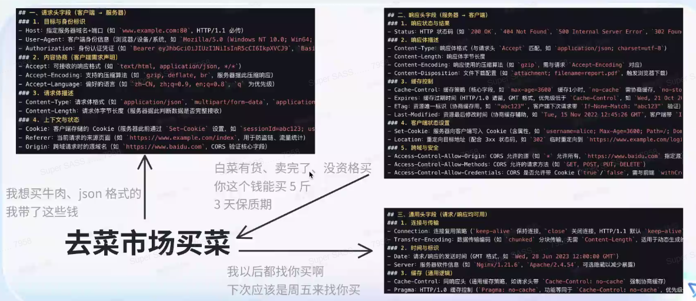
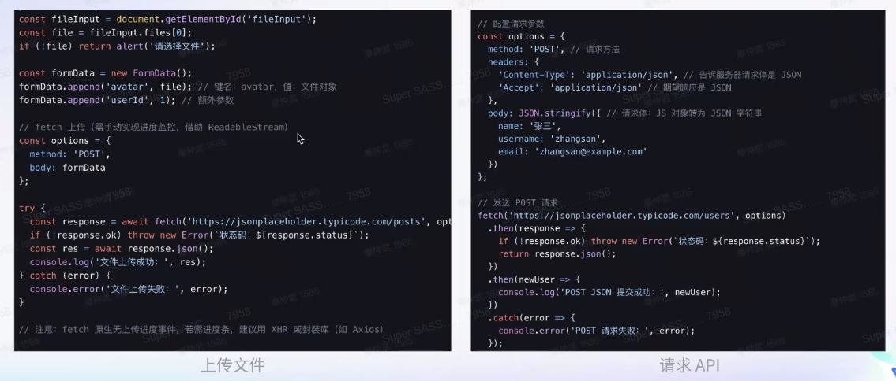
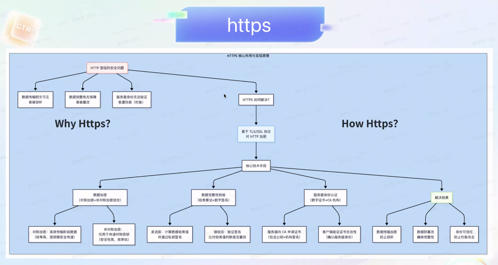
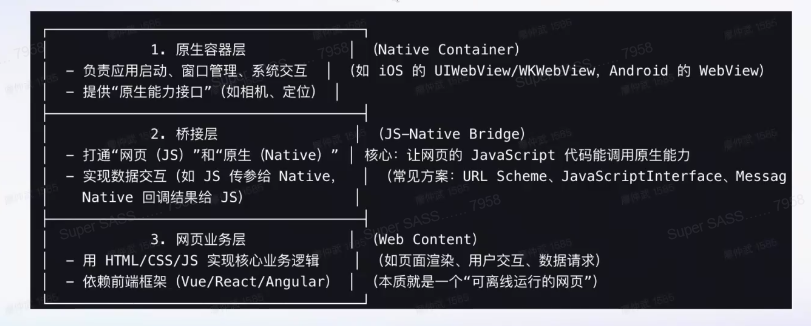
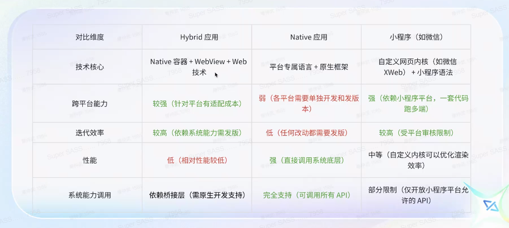
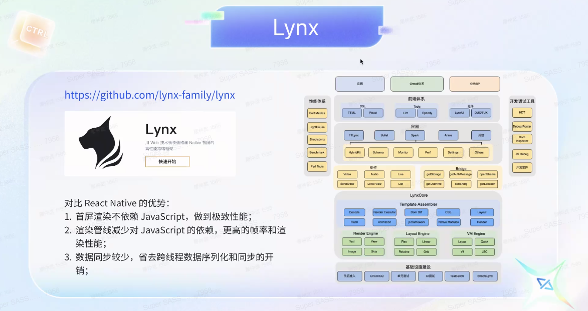

# 第三课 - 网络(IO)与 Hybrid 应用

IO 传输（HTTP）是现代 Web 应用的基础，而 Hybrid 也是现在移动互联网最常用的计数模式。  
Lynx 是字节的 Hybrid，在抖音广泛使用。

## 一、HTTP 相关

### 1. HTTP 介绍

* 请求头
  * `Content-Type`：请求体格式，HTML`text/html`、API`application/json`、均可`*/*`
  * `Accept`：接受的相应格式
* 响应头
  * `Status`：状态码（响应结果）
  * `Content-Type`：响应体格式
* 通用头
  * `Connection`：建立长连接`keep-alive`

**特点**：

* 无状态：不记录历史交互信息（不知道是否登陆过、是否交易过），需要用`cookie`/`session`补充状态
* 无连接(HTTP 1.0)：每次请求后则关闭，导致每次都要重新建立。HTTP 1.1 引入长连接解决该问题
* 可扩展：可自定义 Header，达成私人协议
* 媒体无关：支持任意类型数据，通过 MIME 指定

### 2. 前端 HTTP 客户端

按时间发展顺序。

#### 1. XHR

全称 XMLHttpRequest。是开始的 HTTP 客户端。  
通过回调函数的方式处理响应，并且配置麻烦。

像 Axios 就是对 XHR 的良好封装。  
*注：Ajax 是一种技术的总称，XHR, Fetch都是 Ajax 的实现*

#### 2. Fetch

通过 Promise(async/await) 的方式处理响应，  
并且对 API 的调用通过参数进行封装，可以通过配置参数来发起/管理请求。

### 3. HTTPS

HTTP 明文传输，不安全。

**有关证书信任**：

只要你是个正常的良好的网站，就可以找第三方机构去申请证书，即让第三方进行担保，  
而这个是有成本的，故像 12306 之前就可能考虑到成本没有证书，出现不被信任的网站这个问题。

### 4. HTTP 2.0

只有 HTTPS 支持 2.0。

改进点：

* 默认长连接
* 大文件传输
* 服务器资源推送

## 二、相关网络技术

### 1. 多线程

> JS 是单线程的解释：
>
> 主要是 JS 的 UI / 渲染工作运行在单线程（主线程）上，通过`while (true)`实现（但可以通过异步`Promise`调整执行顺序，但仍然是单线程），  
> 而这也是必要的，基本所有的 UI 渲染工作都是单线程（比如 C# WPF，UI 线程也是单线程）
>
> 但现在 JS 也是支持多线程的，可以把计算密集任务、IO 放在非 UI 线程中，  
> 这种线程是不能涉及 UI 操作的，比如操作 DOM（类比，C# WPF 也不允许在多线程里操作 UI）。

* WebWorker
* ServiceWorker：更现代常用
  * 管理缓存
  * 离线功能：无网环境应用，把简单应用的功能缓存下来

### 2. WebSocket

HTTP 是单工通信，客户端只能向服务端主动发送，服务端不能主动向客户端发送。  
以前只能通过如客户端轮询的方式邪道实现。

故推出 WebSocket 这种双工通信方式。

可做聊天器应用等。

## 三、Hybrid 应用

融合了原生应用（Native App）和网页应用（Web App）技术特性的**跨平台应用**形态。

* Native 提供原生功能：文件管理、设备使用等
* 提供底层性能优化
* 复用 Native 资源（如本地文件缓存）

*像 React Native 就是一种 Hybrid 应用框架。*

### 1. Hybrid

* VDOM：将 UI 结点抽象化。参考 Diff 实现方式
* Canvas：绘图引擎