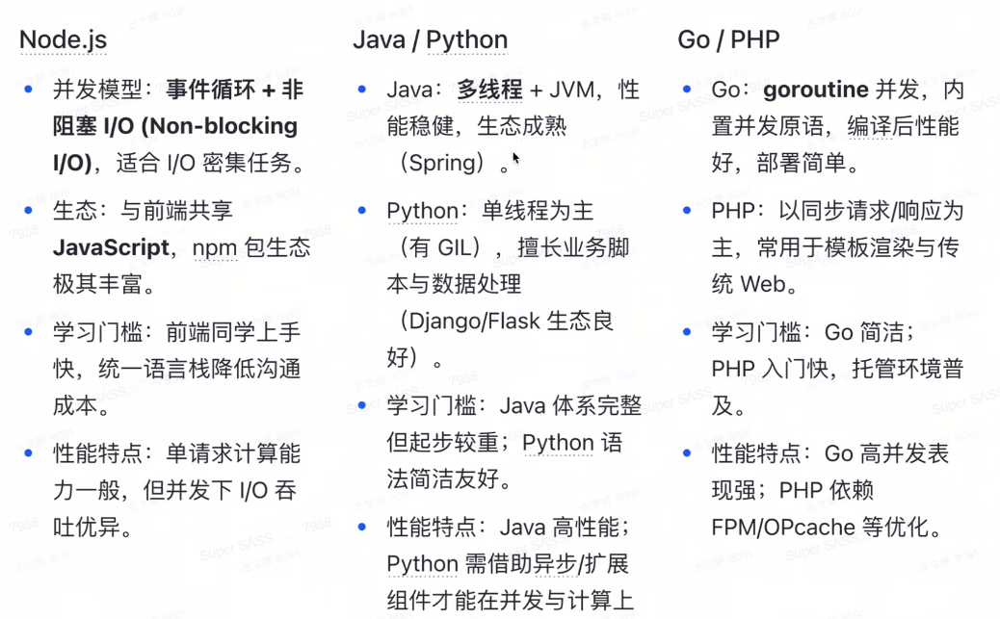
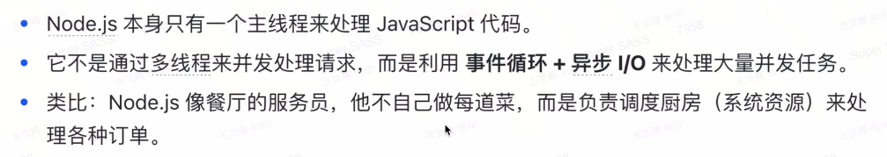
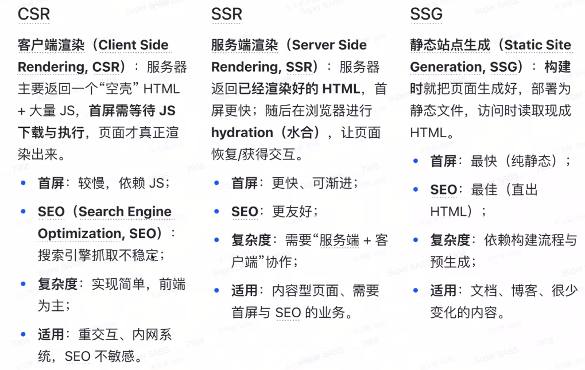
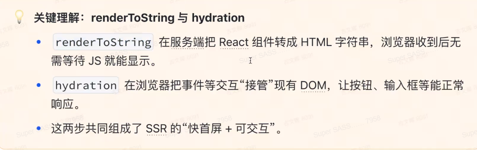

# 第四课 - Node.js 与 React 服务器渲染(SSR)

本课程将教会最小可运行的服务端渲染示例

## 一、基础概念

### 1. Node.js

`Node.js`则是把 JS 带到服务器上，可以用 JS 来**编写后端代码**。  
其底层依赖 V8 引擎，并用**事件循环**来处理大量并发请求。

**与其它后端语言对比**：

* Node.js
  * I/O密集型，适合请求比较多的场合（并发 I/O 能力优秀，但单请求的计算能力一般）
  * 前后端语言一致，统一语言栈
  * 在渲染 HTML 时更有优势，开发 SSR 更友好
  * 不适合 CPU 密集型（有很多计算，`for`/`while`循环）

**使用准备**：

* 使用`nvm`管理`node`版本（类似`venv`）
* 使用`npm`管理包（类似`pip`）

**核心原理**：

1. Node.js 是单线程的
   
2. 事件循环
   1. 异步 I/O（如`fs`文件读取，不会阻塞主线程）
   2. `Promise` / `async`+`await`

### 2. SSR, CSR, SSG

**是什么**：

直接把 React 组件渲染成完整的 HTML，收到后就是完整的页面，**渲染过程在后端**，  
随后加载 JS 进行 hydration(水合, 吸水) —— 把交互能力挂上去。

而现在的 CSR（客户端渲染），就是 HTML 只有一个`
`，其它组件都是用 JS 后续更新出来的，渲染过程在前端。

> SSR 的用户体验肯定更好，但有时候如果服务端压力过大，可能会降级为 CSR（让客户端分摊压力）。

注意：SSR 还不是完全在服务端中完全渲染完成，那个是 SSG（如博客网站引擎）。  
比如 SSR 可渐进（只做首屏的 SSR，其它仍然 CSR）

**区别**：

## 二、教程

### 1. 前置

1. 可以用 node 20 以上
2. 使用 React 18（与 17 有很大区别，建议直接使用 18）

### 2. 编写 server.js

* 一般用`const x = require()`，但现在也支持`import`
* 如果是`js`，只能用`React.createElement`方式  
  但也可以用`jsx`
* **核心方法**：`ReactDOMServer.renderToString(React.createElement(App));`，将`<App>`转换为 HTML 字符串。  
  但**注意**：这里只是组件的 HTML，但需要`<head>`、`<body>`等内容，  
  故需要创建个模板`const html = ... {appHtml} ...`，然后返回。
* **水合**：`ReactDOMServer.hydration`

**要点**：

1. 服务器标记必须与客户端组件一致

### 3. 优化点

* 将任务拆解：将 10s 的渲染拆成 2 个 5s 的渲染。
* 流式渲染(`renderToPipeableStream`)
* 缓存、静态化
* 错误边界、回退 UI：SSR 失败，回退 CSR

## 三、作业

使用`koa`框架（替代`express`）。