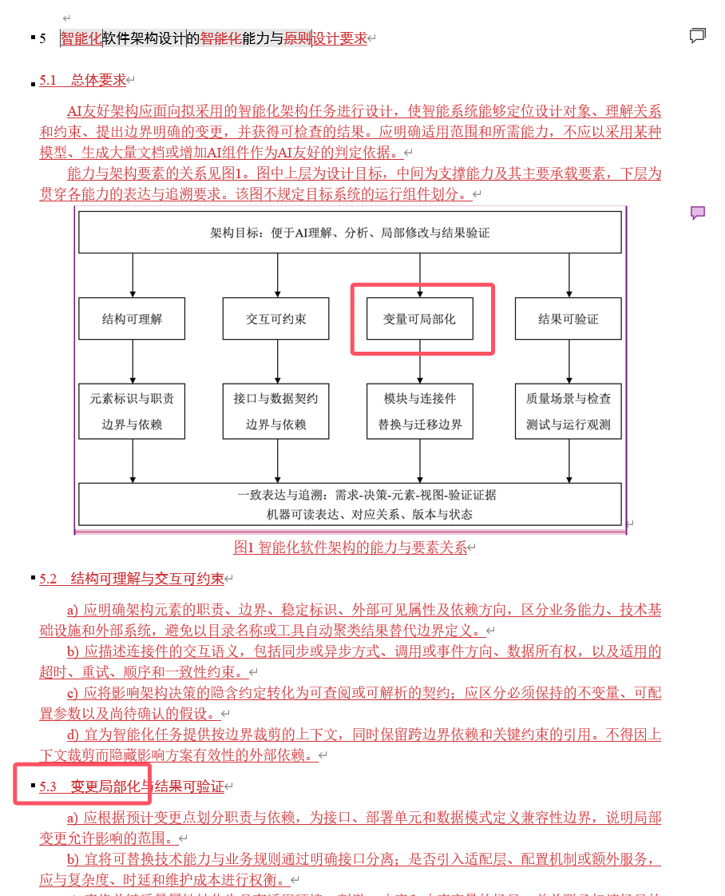
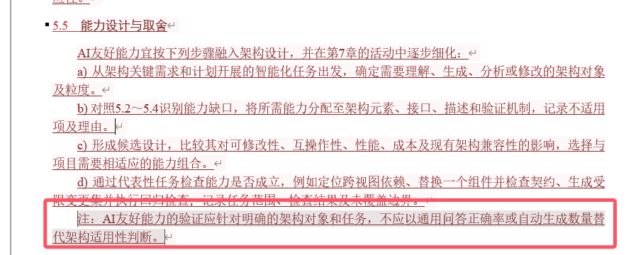
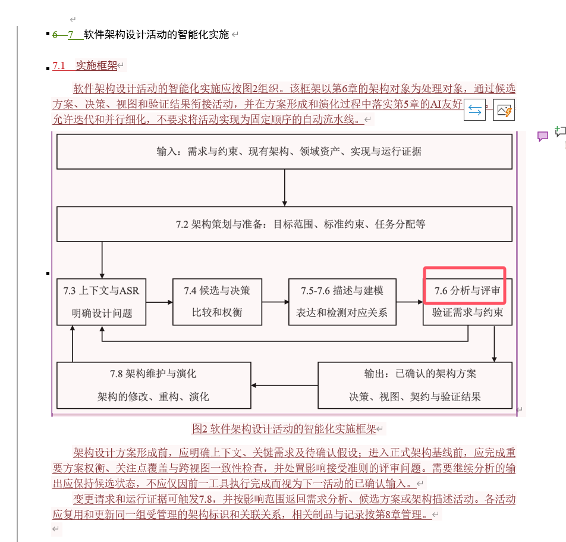
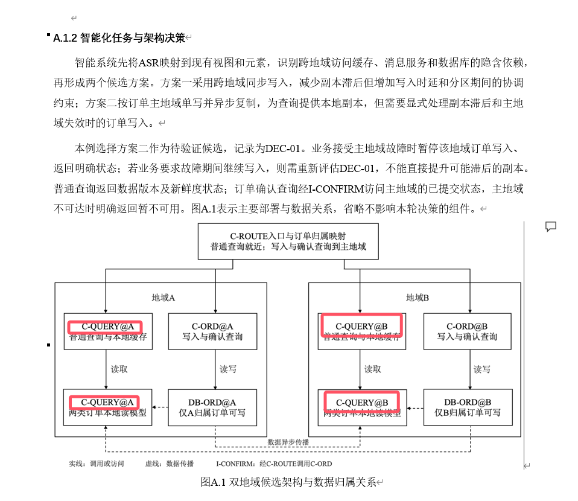
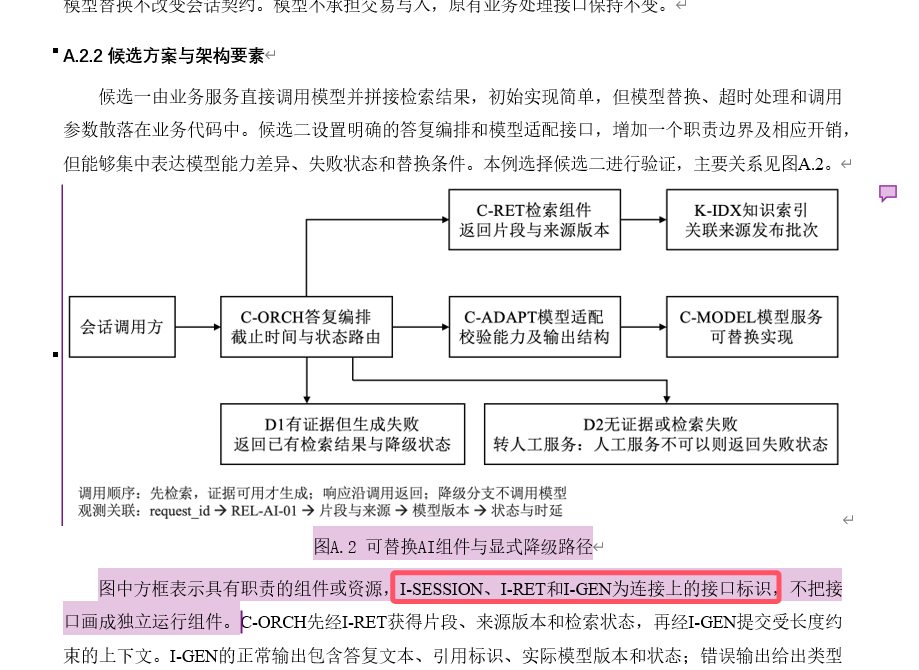

# 蒋添爱批注

## 1. 图 1 与正文描述不一致

该图中“变量可局部化”与下方5.3“变更局部化”不一致。

**修正**：图中应改为“变更可局部化”

## 2. 5.5 中注释部分应上升为正文

该段约束验证对象和判定依据，属于实质条款。其技术内容有价值，应保留。

**建议**：删除“注：”，将该段升为5.5正常条文

## 3. 图 2 编号错误

图中的“7.6分析与评审……”编号错误。

**修正**：编号应为7.7。

## 4. 图 A.1 标识重复

该图中：“普通查询与本地缓存”与“两类订单本地读模型”两个不同组件，却都标识为C-QUERY；应区分为不同标识

**建议**：查询组件保留C-QUERY，本地读模型另命名为R-ORDER或其他独立标识

## 5. 图 A.2 与正文无法对应

图下的正文说“I-SESSION、I-RET和I-GEN为连接上的接口标识”，但图中却没有。

**建议**：将I-SESSION标在会话调用方与编排组件之间，I-RET标在编排与检索组件之间，I-GEN标在编排与模型适配组件之间，或按起草组确认的接口边界调整正文。D1、D2表示处理分支，宜与组件／资源的图形或图例区分；图中文字“人工服务不可以则返回失败状态”改为“人工服务不可用时返回失败状态”。

