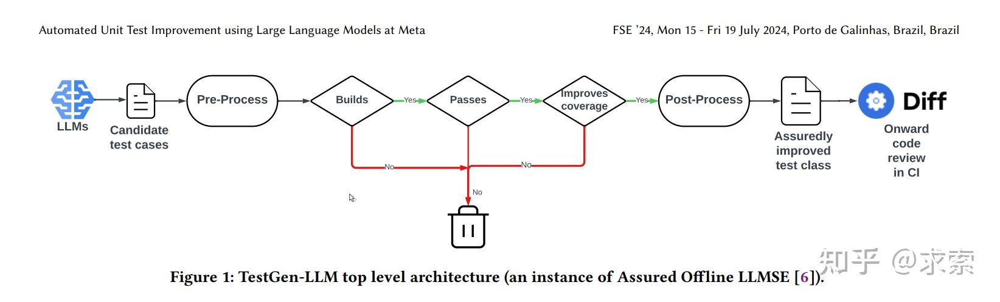
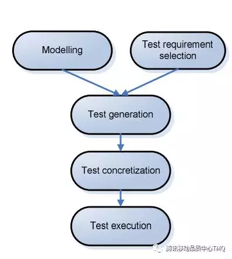

# 相关工作调研

* 纯软件方向
  * 场景通常定义：测试场景(Testing Scenario)代表应用程序中的一个**特定功能或任务**,它从最终**用户的角度**封装了一个**完整且自洽的业务逻辑**。  
    要素：用户目标（What） + 操作序列（How） + 预期结果  
    根据实际运用，有很多不同表示方法：最常见的是自然语言（目标+操作（包含验证）+结果），也有 UML/形式化【引用自Generating Test Scenarios from NL Requirements using Retrieval-Augmented LLMs: An Industrial Study，"Based on project requirements and the development environment"】
    > 与测试用例的区别：
    >
    > 测试用例是开发角度、技术导向的、代码 → 测试用例 → 执行，  
    > 测试场景则是用户角度、业务导向的、用户需求 → 测试场景 → 测试用例 → 执行。
    >
    > 在部分论文中，相当于声明式与命令式的区别，其中测试场景只输入用户目标（预期结果由方法自行判断），操作序列由方法生成。
    > * 测试场景是声明式的，告诉要做什么（What），是粗粒度、高层次的，比如“用户登录”；  
    >   测试场景 = 用户目标
    > * 测试用例是命令式的，除了做什么还要说怎么做（How），还包括细粒度、具体的步骤，比如“用户登录：1. 点击；2. 输入……”  
    >   测试用例 = 用户目标 + 操作步骤 + 预期结果
  * GUI 测试（基于测试场景（目标）生成测试步骤）
    * **LLM-Guided Scenario-based GUI Testing**  
      以及其中提到的三种基线方法
  * 测试场景（用例）生成
    * SymPrompt  
      论文：Code-Aware Prompting: A study of Coverage Guided Test Generation in Regression Setting using LLM  
      在传统符号分析的测试方法上改进
    * 字节: Fastbot
    * Meta: TestGen-LLM  
        
      使用 LLM 生成测试用例，并验证1) 编译通过; 2) 增加覆盖率
    * Generating Test Scenarios from NL Requirements using Retrieval-Augmented LLMs: An Industrial Study
  * *拓展：基于模型的测试(Model-Based Testing, MBT)*  
    对被测对象构建一个“测试模型”（e.g. 状态机、马尔科夫链），然后由模型生成测试用例，执行并验证。  
    
    * 工具
      * GraphWalker：基于测试模型的用例生成工具
* 实物方向
  * 场景生成
  * 场景识别

---

TODO：

* 阅读一下“Code-Aware Prompting: A Study of Coverage-Guided Test Generation in Regression Setting using LLM”，继续搞清测试场景的定义、与测试用例区别；然后弄懂其中的 SymPrompt 方法（在总调查里问问他哪有符号执行）
* 补充一下 Fastbot、TestGen-LLM（工业界方法）
* 看一下三个 baseline：GPTDroid（总调查里也有提及）、ScenTest、ASOT
* 看看总调查里的精读论文：QTypist、Fastbot2、LLM4Fin
* 看一篇总调查里扩展的“类别C:组合测试与场景优化”
* 调研实物方向（先做）
   接下来请你调研第二个大方向——基于场景的实物测试方面,偏重无人艇、无人机、无人机群、无人车(已按重要性排序),着重找那些有详实的、可复现可参考的工作论文,比如仿真平台、游戏(如之前我了解的CMO(Command Modern Operations))等,因为我们目前缺乏对这种实物的实验仿真方法手段。注意：
   1. 你的调研应当客观真实(比如对于上次的调研中的软件测试经历六个阶段,参考的材料并没有写“场景导向期(2000-至今)”,这是你自行根据本次调研主题强行加上去的,这样不好,请按照所参考材料真实整理撰写)。
   2. 对于出自论文的工作，首次出现时给出准确的论文引用

---

* 游戏引擎，不单纯是简单的app
* **游戏 Agent**
