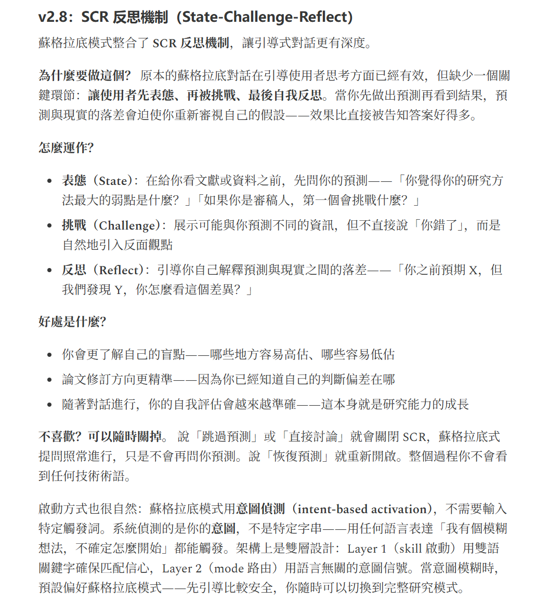
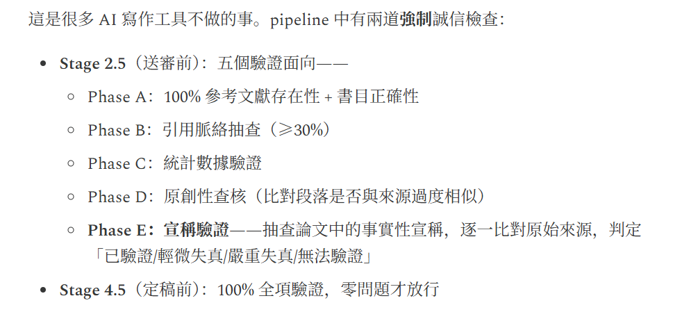
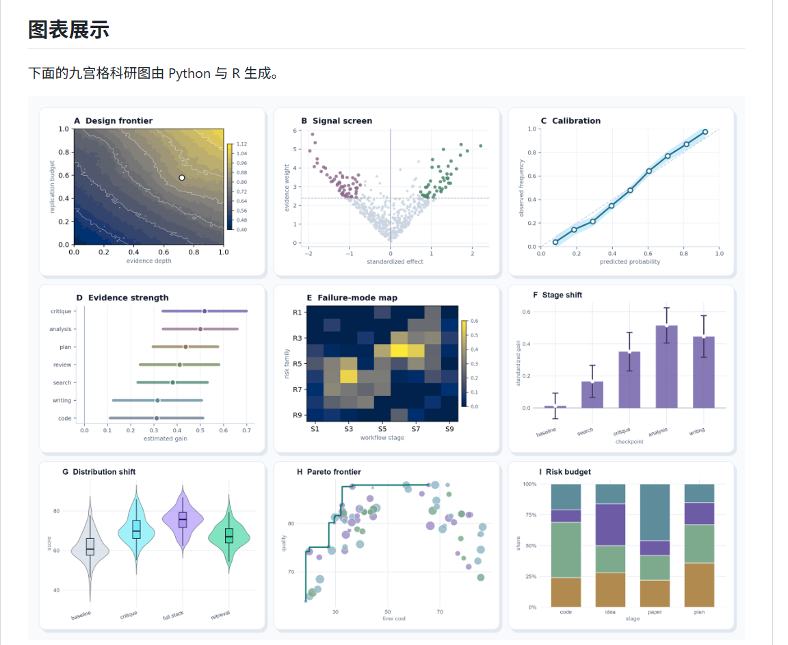
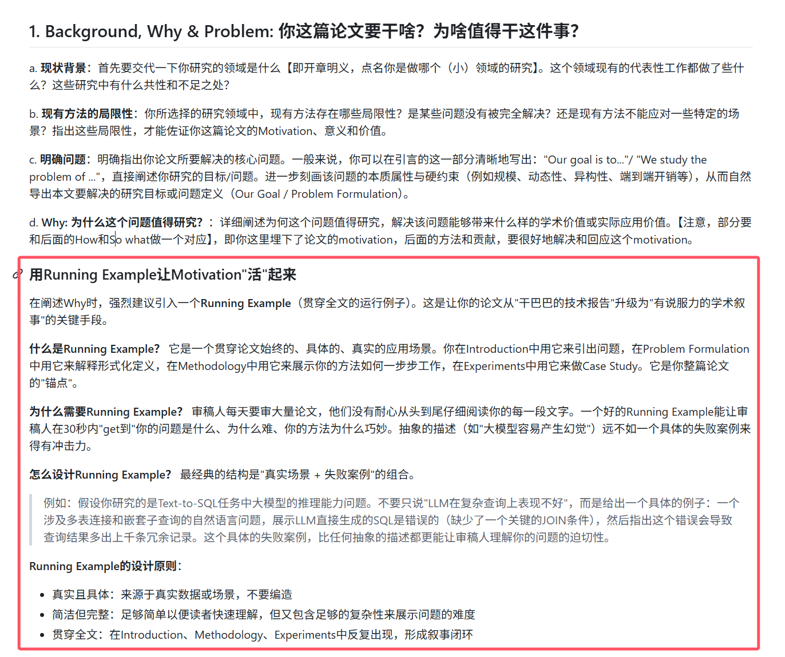

# 科研工具

* Claude Scholars：
  * **整体评分** - 5/5：
  * **作者国家** - 5/5：中国
  * **平台** - 5/5：Codex / Kimi 兼容
  * **面向** - 5/5：**原生 CS / AI**
  * **完善度** - 5/5：有完整工作流，澄清调研、（设计计划好像没看到？）、实验、分析、写作；集成 Zotero、Obsidian（知识库基建）
  * 缺点：
    * 定位不是端到端全自动化，而是以人决策为中心的 human-in-loop 辅助
* 切问学术：
  * 整体评分：4/5
  * 优点：
    * 可配置 GPU 实验
* [Open Science](https://github.com/ai4s-research/open-science/blob/master/README.zh.md)
  * 整体评分：4/5
* [ARIS（Auto-claude-code-research-in-sleep）](https://github.com/wanshuiyin/Auto-claude-code-research-in-sleep)
  * **整体评分** - 5/5：
  * **作者国家** - 5/5：国内，有小红书经验
  * **平台** - 4/5：首推 Cluade + Codex，可配置其他
  * **面向** - 5/5：**原生 CS / AI**
  * **完善度** - 5/5：**有完整端到端工作流**，调研澄清、设计方案、实验实现与迭代、写论文
  * 优点：
    * 双 Agent Loop：持续跑
    * **可配置 GPU 实验**：
    * 有真实论文产出案例
* [ARS（Academic Research Skills）](https://github.com/Imbad0202/academic-research-skills)
  * **整体评分** - 3/5：非原生 CS 面向扣大分
  * **作者国家** - 4/5：台湾
  * **平台** - 4/5：主 Cluade，有 Codex 兼容
  * **面向** - 2/5：**非原生 CS**，更多偏向 Science，流程**不包含跑实验**（但提供外部扩展，但其也更多偏向数学/统计类型的）
  * **优点**（可采纳）
    * 想法澄清、生成 idea：苏格拉底式、SCR 反思
      
    * 送审前检查：检查引用诚信
      
* [Light](https://github.com/Light0305/Light-skills)
  * **整体评分** - 2/5：知名度比较低，没有强大社区
  * **作者国家** - 5/5：国内
  * **平台** - 5/5：Skill 组织
  * **面向** - 3/5：**非原生 CS**，偏向其他工科
  * 缺点
    * 更新 2 月前
  * 优点（可采纳）：
    * 科研画图效果好：使用 Python / R 来数据图（但感觉不用这个也行）
      
* [Supervisor-Skills](https://github.com/HKUSTDial/Supervisor-Skills)
  * **整体评分** - 3/5
  * **作者国家** - 5/5：国内
  * **平台** - 5/5：Skill 组织
  * **面向** - 5/5：**原生 CS / AI**
  * 缺点：
    * 有些老，并非对应最新的 AI 能力
    * 只是纯 skill，缺流程引导，缺 loop
    * 实验相关的能力不是很完善，没有指导
  * 优点（可采纳）
    * ⭐**科研说明书**：[完成一篇科研论文，你需要做几件事情](https://github.com/HKUSTDial/Supervisor-Skills/blob/main/handbook/03_Paper_Writing/3.1_%E5%AE%8C%E6%88%90%E4%B8%80%E7%AF%87%E7%A7%91%E7%A0%94%E8%AE%BA%E6%96%87%E4%BD%A0%E9%9C%80%E8%A6%81%E5%81%9A%E5%87%A0%E4%BB%B6%E4%BA%8B%E6%83%85.md)
      