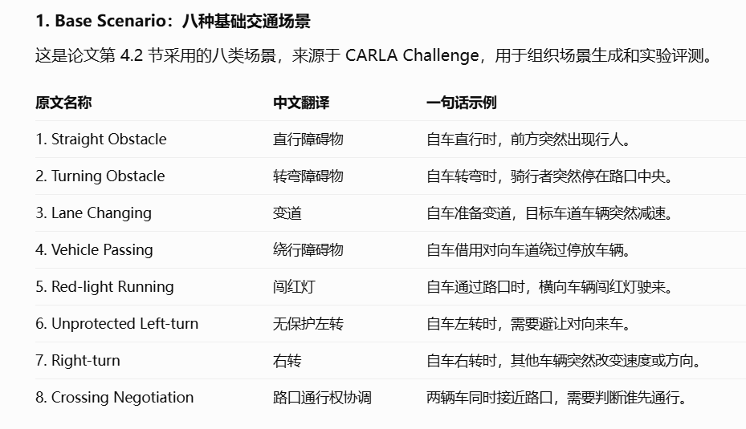
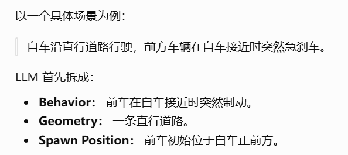
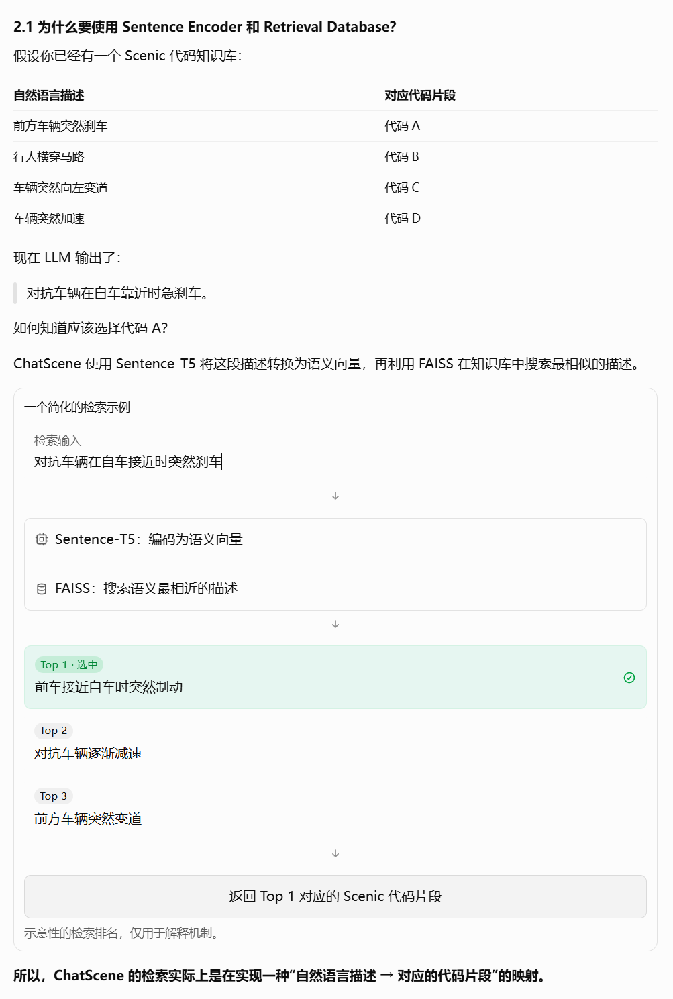
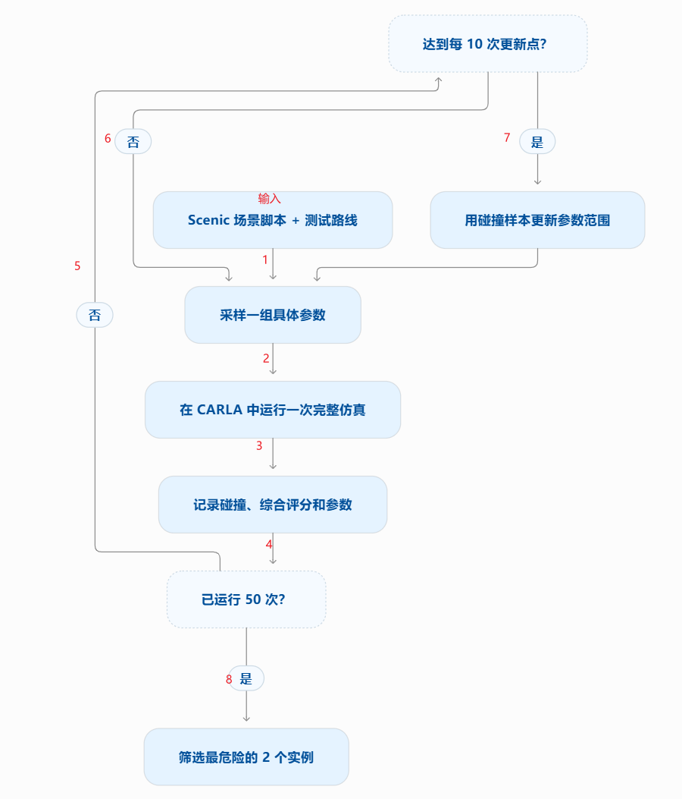
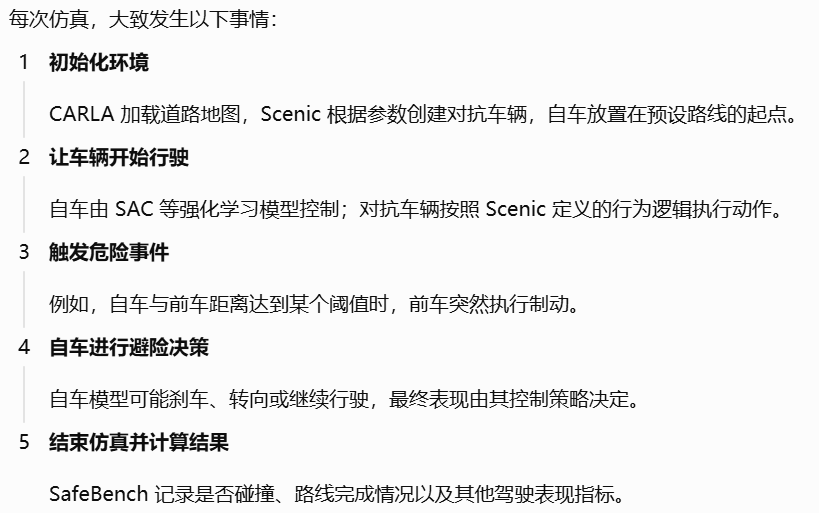
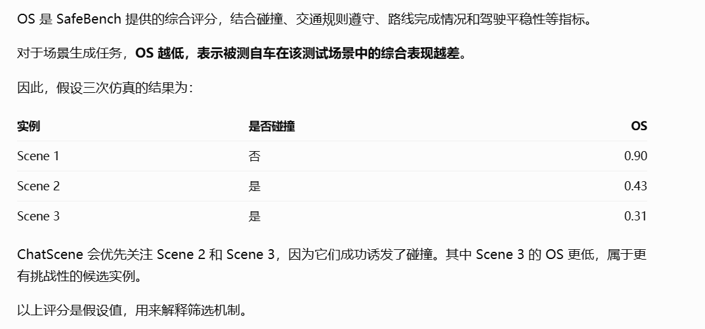
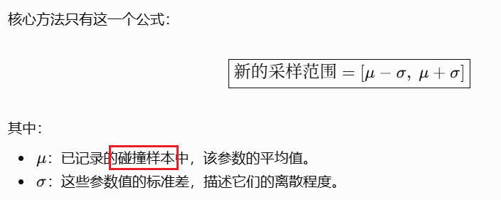
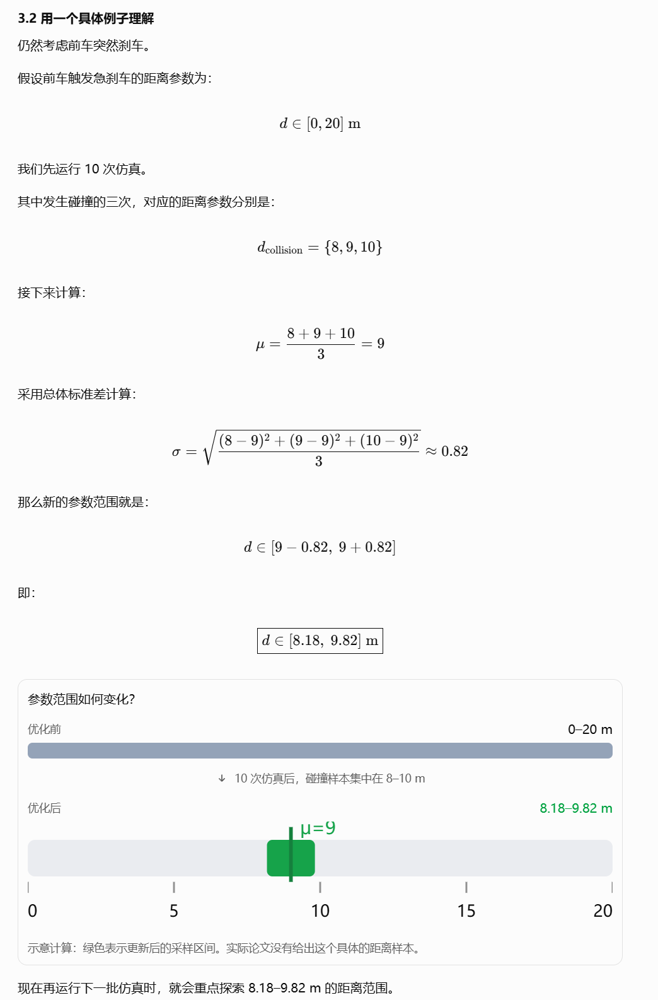
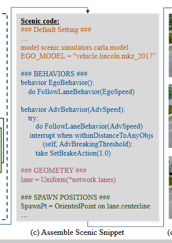

## 场景生成 - LLM

### ChatScene - CVPR 2024

> **一句话**：用户输入想构建的场景，利用大语言模型已有的交通知识，构思可能让自动驾驶汽车发生事故的危险情境，再通过检索和组合已有的仿真代码，把这些情境转化为可以运行的测试场景。

* **关键问题**
  * **生成**——如何从自然语言生成可运行的 CRALA 仿真场景
    * 分别检索出来的三个代码片段，究竟如何确保组合后仍然语义一致、符合 Scenic 的语法，并且能在 CARLA 中成功运行？
  * **优化**——如何找到更危险的测试用例
* **场景层级**
  * Base Scenario：只考虑 8 大类场景
    
  * Scenario：8 类中某一类下的逻辑场景（带参数范围的场景）
  * Scene：某 Scenario 的具体场景
* **方法 Pipeline**
  1. （Pre）构建 Scenic 代码知识库：`(语义文本描述, 代码片段)`
  2. **场景生成**
     1. 输入自然语言
     2. LLM 拆为 Geometry、Spawn Position、Behavior 三个组件
        
     3. 检索 DB，形成组件对应的 Scenic 代码片段
        * 方法：Sentence-T5（文本 -> 语义 vec）+ FAISS（语义临近检索）
          
     4. 最后组合成完成脚本（实际为逻辑场景，Scenario）
        * 定义的是参数范围，如`param ADV_SPEED = Range(0, 10)`（对抗车速度）
  3. **场景运行与优化**
       
     ⭐**一句话目的**：记录场景价值（OS，能让 Ego 表现差）、逐渐生成更危险（OS 更低）的场景（基于是否碰撞优化参数范围）
     1. 基于 Scenic 自带的采样方法，可从逻辑场景 -> 具体场景（Scene）*（应该是随机采样）*
     2. 将 Scene 放到 CARLA 运行
        
     3. 记录仿真结果（所用参数、是否碰撞、**挑战评分(Overall Score, OS)**）
          
     4. （如果到达更新时机）基于记录更新参数范围（“Refinement of Collision-Prone Parameters”），  
         
         > 举例：  
         > 
         > 可以看到显著优化了参数范围
     5. 完成采样次数，**选择 OS 最低**的 2 个 Scene，作为最终的 Danger Scene。

     三个方法参数：
     * `sample_num: 50`：采样 50 次并运行
     * `opt_step: 10`：每 10 次更新
     * `select_num: 2`：最终选择 2 个 Danger Scene
* **仿真平台**：Scenic 脚本 + CARLA 平台
  * Scenic 脚本分为四个部分
    
    * （静）Default Setting
    * （静）Geometry
    * （静）Spawn Position
    * （动）Behavior
* **测评体系/实验框架**：SafeBench
  * 一句话定义：CARLA提供仿真（只运行）；SafeBench在此基础上组织测试任务、运行不同算法（智驾模型）、计算评价指标。
  * **预先定义了 8 类 Base Scenario，以及其中的多个 Route**  
    *这也是为什么 ChatScene 以这 8 类生成，因为直接可以用 SafeBench*
* **实验**
  * 背景知识——智驾模型
    * SAC
    * PPO
  * **两类实验**
    * **#1 危险场景生成效果**：看 ChatScene **生成的场景**能否使被测自车**暴露更多安全问题**。
    * **#2 对抗训练效果**： 看使用 ChatScene 场景**进行微调**后，自车能否在危险情境下**表现得更好**。
  * **完整流程**
    1. **场景生成**：Ego 先用 SAC 模型，跑生成方法，**得到最终 2 个 Danger Scene**
       * 仿真采样（运行）次数：8 类 Base * 5 个 Scenario * 10 条 Route（路径，即Ego 路线、不同的起点路径点终点） * 50 次采样运行优化 = 20000 次
       * 生成最终 Danger Scene：8 * 5 * 10 * 2 = 800 个
    2. **#1**：Ego 分别用 SAC、PPO、TD3 模型，测试 Danger Scenes 下的指标
       * 碰撞率（CR）
       * Overall Score（OS）：**SafeBench**
       * 平均位移误差（ADE）：评价场景多样性
    3. **#2**：用 Danger Scene 微调 Ego 的策略（SAC），再测试微调后的安全性能

TODO：

### AutoScenario - arxiv 2024.11

> **一句话**：让用户通过自然语言、事故报告、真实道路图片或行车视频，自动生成能够在仿真器中运行的自动驾驶危险测试场景。

* 特点
  * 输入多模态
* 仿真平台：SUMO

### LLMScenario - 

## 场景测评

### SafeBench - NeurIPS 2022

* **核心贡献**
  * 平台贡献：提供统一的场景组织、算法运行、自动驾驶模型**训练与安全评测框架**。
  * 实验贡献：**实现并改编四种场景生成方法**，生成大量安全关键测试用例，比较不同生成方法的效果
* 适配生成算法

| 方法                                      | 类型    | 如何生成测试场景                     |
| --------------------------------------- | ----- | ---------------------------- |
| Learning-to-Collide（LC）                 | 对抗式   | 使用策略梯度优化交通参与者的初始位置等参数，增加碰撞概率 |
| AdvSim（AS）                              | 对抗式   | 扰动周围车辆的运动轨迹，利用贝叶斯优化寻找危险轨迹    |
| CARLA Scenario Generator（CS）            | 规则式   | 根据预定义交通规则构造场景，并通过网格搜索组合参数    |
| Adversarial Trajectory Optimization（AT） | 约束优化式 | 在物理和交通约束下，使用粒子群优化搜索对抗轨迹      |

* 